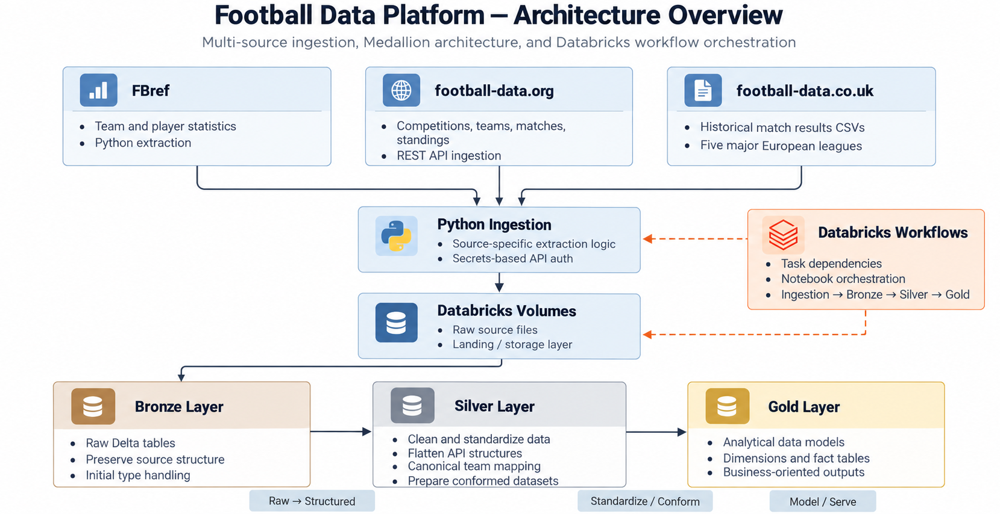
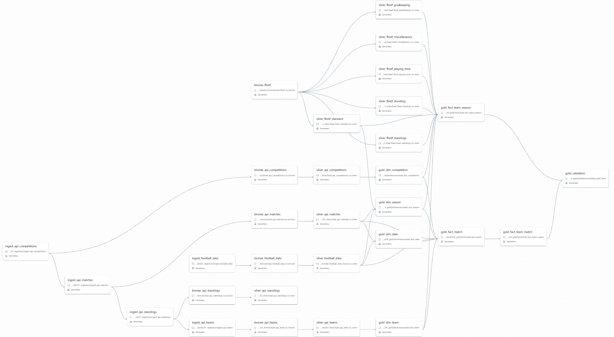

# Football Data Platform

**An end-to-end Data Engineering project built with Python, PySpark, Databricks, and Delta Lake.**

A multi-source data platform that ingests football statistics and match data, transforms heterogeneous datasets through a Medallion Architecture, and produces curated analytical tables.

The primary goal of this project is to demonstrate practical Data Engineering skills through the design and implementation of reliable, maintainable, and scalable data pipelines.

---

## Tech Stack

| Category | Technologies |
|---|---|
| Programming | Python, SQL, PySpark |
| Data Platform | Databricks |
| Storage | Delta Lake, Unity Catalog Volumes |
| Architecture | Medallion Architecture (Bronze / Silver / Gold) |
| Orchestration | Databricks Workflows / Jobs |
| Version Control | Git, GitHub |
| Planned Enhancements | pytest, GitHub Actions, Databricks Declarative Automation Bundles |

---

## Architecture Diagram

The platform follows a layered architecture that separates ingestion, raw storage, standardization, and analytical modeling.

---

## Pipeline Workflow

Below is the current Databricks workflow DAG showing the orchestration of ingestion, Bronze, Silver, and Gold tasks.

---

## Data Sources

The platform integrates three independent football data providers.

| Source | Data | Ingestion Method |
|---|---|---|
| [FBref](https://fbref.com/) | Detailed team and player statistics | Python-based extraction |
| [football-data.org](https://www.football-data.org/) | Competitions, teams, matches, and standings | REST API |
| [football-data.co.uk](https://www.football-data.co.uk/) | Historical football match results | CSV downloads |

The current scope covers five major European domestic leagues:

- Premier League
- La Liga
- Bundesliga
- Serie A
- Ligue 1

Historical coverage currently spans the **2021/22 to 2025/26** seasons, subject to source availability.

---

## Architecture Overview

The project follows a Medallion Architecture:

### Bronze Layer
Raw Delta tables loaded from ingested source data.

**Responsibilities:**
- Preserve source-level information
- Load heterogeneous source files into Delta Lake
- Perform initial schema handling and type normalization
- Provide a stable handoff to downstream transformations

### Silver Layer
Cleaned and standardized datasets prepared for analytical use.

**Responsibilities:**
- Clean and normalize source data
- Standardize schemas and field names
- Flatten nested API responses
- Handle optional and semi-structured fields
- Standardize club identities across independent sources
- Prepare conformed datasets for downstream modeling

### Gold Layer
Business-oriented analytical tables built from Silver datasets.

**Responsibilities:**
- Build analytical dimensions and fact tables
- Organize data around analytical use cases
- Deliver curated outputs instead of exposing raw source structures

---

## Key Engineering Features

### 1. Multi-Source Data Integration
Each data source exposes different formats, schemas, and naming conventions.  
The platform uses source-specific ingestion logic and standardized downstream transformations to integrate them into a unified architecture.

### 2. Canonical Team Mapping
The same football club may appear under different names across sources.

Examples:
- Manchester United
- Man United
- Manchester Utd

A canonical team mapping mechanism standardizes these values to support:
- reliable cross-source joins
- consistent team identifiers
- controlled maintenance of mapping datasets
- detection of previously unmapped team names

### 3. Schema Standardization
Some source datasets, especially FBref extracts, may contain inconsistent inferred data types across files or seasons.

The ingestion and transformation logic addresses:
- schema inconsistencies
- data type conflicts
- Delta compatibility issues
- repeatable loading of evolving source data

### 4. Semi-Structured Data Processing
REST API responses can contain nested objects and optional fields.

Reusable PySpark utilities support:
- nested field existence checks
- safe extraction of optional fields
- flattening semi-structured responses
- consistent transformation logic

### 5. Workflow Orchestration
Databricks Workflows coordinates the end-to-end pipeline.

Execution flow:
**Ingestion → Bronze → Silver → Gold**

This replaces manual notebook execution with a dependency-driven workflow.

---

## Engineering Challenges Solved

| Challenge | Implemented Approach |
|---|---|
| Heterogeneous source systems | Source-specific ingestion + standardized Medallion processing |
| Inconsistent team naming | Canonical team mapping and unmapped-name detection |
| Conflicting source data types | Schema normalization and type handling |
| Nested API structures | Reusable PySpark utilities |
| Multi-stage dependency management | Databricks Workflows orchestration |
| Evolving project scope / data providers | Adaptable ingestion design |

---

## Project Status

**Current stage:** End-to-end pipeline implemented; reliability and automation enhancements planned.

### Implemented
- [x] Python ingestion from multiple football data sources
- [x] Raw file storage in Databricks Volumes
- [x] Bronze Delta tables
- [x] Silver transformations in PySpark
- [x] Canonical team mapping
- [x] Reusable transformation utilities
- [x] Gold analytical datasets
- [x] End-to-end Databricks workflow orchestration
- [x] Git and GitHub version control

### Roadmap
- [ ] Strengthen incremental processing and idempotency
- [ ] Add systematic data quality validations
- [ ] Implement automated tests with pytest
- [ ] Improve logging and error handling
- [ ] Add pipeline monitoring and observability
- [ ] Introduce CI/CD with GitHub Actions
- [ ] Automate deployment with Databricks Declarative Automation Bundles
- [ ] Finalize documentation and reproducible setup instructions

---

## Development Principles

This project is built with a production-oriented mindset.

Key principles:
- **Separation of concerns** — ingestion, standardization, and analytical modeling have distinct responsibilities.
- **Maintainability** — reusable logic and modular notebook design reduce duplication.
- **Reliability** — future work prioritizes validation, testing, idempotency, and observability.
- **Pragmatism** — technologies are added only when they solve a clear engineering problem.
- **Business-oriented modeling** — the Gold layer is designed around analytical use cases, not raw source structures.

---

## Project Purpose

The Football Data Platform is a self-directed portfolio project designed to demonstrate practical experience in:

- building end-to-end ETL / ELT pipelines
- processing heterogeneous data with Python and PySpark
- designing Delta Lake-based Medallion Architectures
- standardizing entities across independent data sources
- modeling analytical datasets
- orchestrating multi-stage workflows in Databricks
- applying software engineering principles to data workflows

The football domain provides realistic, evolving datasets, while the core focus remains **Data Engineering architecture, implementation, and reliability**.

---

## Author

Developed as a personal Data Engineering portfolio project with a focus on modern data platforms and production-oriented engineering practices.
